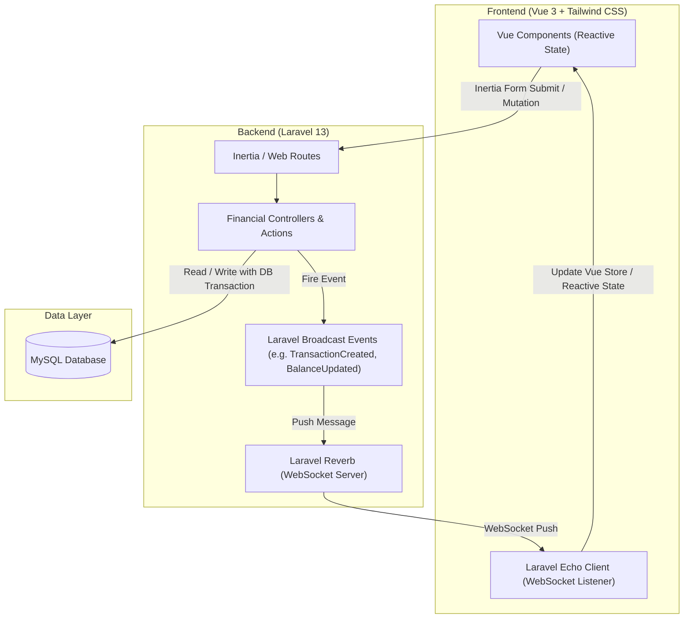
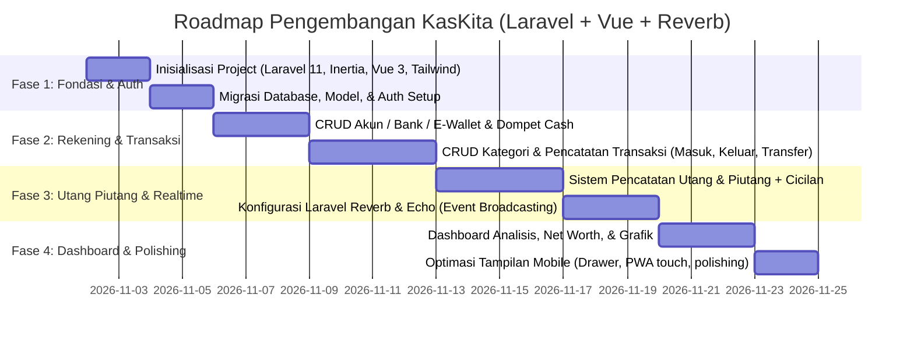

# Product Requirements Document (PRD) & Arsitektur Sistem
## Sistem Manajemen Keuangan Pribadi & Multi-User ("KasKita / FinTrack")

---

## 1. Ringkasan Eksekutif (Executive Summary)

### 1.1 Latar Belakang & Masalah
Banyak individu menghadapi kendala dalam mengontrol arus kas pribadi mereka karena dana terpecah di berbagai instrumen: beberapa rekening bank konvensional, berbagai dompet digital (*e-wallet*), dan uang tunai fisik (*cash*). Masalah semakin rumit ketika terjadi transaksi pinjam-meminjam (utang dan piutang) yang seringkali hanya diingat secara informal sehingga berisiko lupa, salah hitung, atau mengganggu likuiditas keuangan.

### 1.2 Solusi Produk
Aplikasi **Sistem Manajemen Keuangan Pribadi & Multi-User** adalah platform manajemen finansial berbasis web modern, responsif (*mobile & desktop*), dan mendukung pembaruan data secara **real-time**. Sistem ini memungkinkan setiap pengguna mengelola dompet/rekening secara terpisah, mencatat arus kas masuk dan keluar secara presisi, mengelola buku utang-piutang beserta riwayat cicilannya, serta melihat posisi kekayaan bersih (*Net Worth*) secara instan.

### 1.3 Tech Stack Terpilih
- **Backend:** Laravel 13 (PHP 8.5.12)
- **Frontend / Monolith Modern:** Vue 3 (Composition API) + Inertia.js *(SPA experience tanpa overhead API ganda)*
- **Styling UI:** Tailwind CSS (Mobile-First Responsive Layout)
- **Database:** MySQL 8.x
- **Realtime Engine:** Laravel Reverb (Official WebSockets Server) + Laravel Echo & Pusher.js Client
- **Authentication & Authorization:** Laravel Breeze (Inertia + Vue) dengan isolasi data berbasis `user_id`

---

## 2. Tujuan & Sasaran Produk (Goals & Objectives)

1. **Multi-Akun Akurat:** Pengguna dapat memantau saldo riil di setiap rekening bank, e-wallet, dan uang tunai tanpa selisih.
2. **Pelacakan Utang & Piutang Terintegrasi:** Utang dan piutang terhubung langsung dengan rekening pembayaran/penerimaan dana.
3. **Pembaruan Data Real-Time:** Perubahan saldo, transaksi baru, atau pelunasan utang yang dilakukan dari satu perangkat langsung tercermin di perangkat lain tanpa perlu refresh halaman manual.
4. **Desain Mobile-First & Desktop Friendly:** Tampilan di layar smartphone memiliki navigasi yang nyaman (bottom bar & quick action drawer), sedangkan di desktop memanfaatkan layar lebar dengan visualisasi analitik yang kaya.
5. **Multi-User Ready:** Data tiap pengguna terisolasi sepenuhnya secara aman sehingga sistem siap dibuka untuk publik/pengguna lain.

---

## 3. User Personas & User Stories

### 3.1 Persona
- **Andi (Karyawan & Freelancer):** Memiliki 2 rekening bank (BCA untuk gaji, Jenius untuk freelance), 2 e-wallet (GoPay & OVO), serta sering meminjamkan uang ke rekan kerja atau mencicil barang.
- **Rina (Ibu Rumah Tangga / Wirausaha Kecil):** Sering bertransaksi tunai (*cash*) di pasar, menerima transfer bank, dan perlu mencatat utang belanja warung.

### 3.2 User Stories
| No | Sebagai | Saya ingin... | Agar... |
|:---|:---|:---|:---|
| US-01 | Pengguna | Mendaftarkan akun dan login secara aman | Data finansial saya privat dan hanya bisa diakses oleh saya |
| US-02 | Pengguna | Menambahkan beberapa rekening/bank, e-wallet, dan dompet cash | Saya tahu berapa uang riil yang ada di tiap kantong dana |
| US-03 | Pengguna | Mencatat pengeluaran dan memilih sumber rekening/cash | Saldo rekening yang digunakan langsung terpotong secara otomatis |
| US-04 | Pengguna | Mencatat pemasukan dan memilih rekening tujuan | Saldo rekening tujuan bertambah sesuai nominal |
| US-05 | Pengguna | Melakukan transfer antar-rekening (cth: Tarik tunai dari Bank ke Cash) | Saldo kedua rekening tetap sinkron tanpa dianggap sebagai pengeluaran belanja |
| US-06 | Pengguna | Mencatat utang (uang yang saya pinjam dari pihak lain) | Saya tahu total kewajiban dan tanggal jatuh temponya |
| US-07 | Pengguna | Mencatat piutang (uang saya yang dipinjam orang lain) | Saya bisa menagih tepat waktu dan tahu sisa uang yang belum kembali |
| US-08 | Pengguna | Mencicil atau melunasi utang/piutang menggunakan rekening tertentu | Sisa utang berkurang dan saldo rekening yang digunakan langsung menyesuaikan |
| US-09 | Pengguna | Melihat pembaruan saldo secara seketika (*real-time*) di multi-device | Tidak ada data basi ketika membuka aplikasi di HP dan laptop bersamaan |

---

## 4. Diagram Arsitektur & Alur Data

### 4.1 Arsitektur Real-Time


---

## 5. Skema Database (Entity Relationship Diagram)

```mermaid
erDiagram
    USERS ||--o{ ACCOUNTS : "memiliki"
    USERS ||--o{ CATEGORIES : "memiliki"
    USERS ||--o{ TRANSACTIONS : "membuat"
    USERS ||--o{ DEBTS : "mencatat"

    ACCOUNTS ||--o{ TRANSACTIONS : "sumber dana"
    ACCOUNTS ||--o{ TRANSACTIONS : "tujuan transfer"
    CATEGORIES ||--o{ TRANSACTIONS : "kategori"
    
    DEBTS ||--o{ DEBT_PAYMENTS : "memiliki riwayat"
    TRANSACTIONS ||--o| DEBT_PAYMENTS : "menghasilkan"

    USERS {
        bigint id PK
        string name
        string email UK
        string password
        string currency_symbol
        timestamps created_at
    }

    ACCOUNTS {
        bigint id PK
        bigint user_id FK
        string name "cth: BCA, Mandiri, GoPay, Dompet Tunai"
        enum type "bank, ewallet, cash, investment, other"
        string account_number "opsional"
        decimal initial_balance
        decimal current_balance
        string color_hex
        string icon
        boolean is_active
        timestamps created_at
    }

    CATEGORIES {
        bigint id PK
        bigint user_id FK "nullable untuk default system categories"
        string name "cth: Makanan, Gaji, Transport, Tagihan"
        enum type "income, expense"
        string icon
        string color_hex
        timestamps created_at
    }

    TRANSACTIONS {
        bigint id PK
        bigint user_id FK
        bigint account_id FK "Akun asal (atau sumber dana)"
        bigint to_account_id FK "Akun tujuan (khusus tipe transfer, nullable)"
        bigint category_id FK "Nullable untuk transfer"
        enum type "income, expense, transfer"
        decimal amount
        date transaction_date
        text notes
        string receipt_image_path
        timestamps created_at
    }

    DEBTS {
        bigint id PK
        bigint user_id FK
        string party_name "Nama orang / instansi terkait"
        enum type "debt, receivable" "debt=utang, receivable=piutang"
        decimal total_amount
        decimal remaining_amount
        date due_date
        enum status "unpaid, partially_paid, paid"
        text notes
        timestamps created_at
    }

    DEBT_PAYMENTS {
        bigint id PK
        bigint debt_id FK
        bigint transaction_id FK
        decimal amount
        date payment_date
        text notes
        timestamps created_at
    }
```

### 5.1 Detail Spesifikasi Tabel

1. **`accounts`**:
   - `type`: Enum (`bank`, `ewallet`, `cash`, `investment`, `other`).
   - `current_balance`: Nilai terkomputasi otomatis via DB Transaction setiap kali transaksi terjadi.
2. **`transactions`**:
   - Jika `type = income`: `account_id` bertambah `amount`.
   - Jika `type = expense`: `account_id` berkurang `amount`.
   - Jika `type = transfer`: `account_id` (asal) berkurang `amount`, dan `to_account_id` (tujuan) bertambah `amount`.
3. **`debts` & `debt_payments`**:
   - Saat membuat utang/piutang baru, dapat ditentukan apakah dana langsung masuk/keluar ke rekening tertentu atau sekadar catatan tagihan lama.
   - Setiap pembayaran cicilan dicatat di `debt_payments` dan secara otomatis menghasilkan rekaman di `transactions` sehingga saldo rekening ikut terpotong/bertambah secara konsisten.

---

## 6. Spesifikasi Fitur Fungsional (Functional Requirements)

### 6.1 Modul Manajemen Rekening & Dompet
- **FR-ACC-01:** Pengguna dapat membuat, melihat, memperbarui, dan menonaktifkan rekening (*soft archive*).
- **FR-ACC-02:** Pengguna dapat menetapkan saldo awal (*initial balance*).
- **FR-ACC-03:** Setiap rekening memiliki warna pembeda dan ikon untuk memudahkan identifikasi visual di HP/Desktop.
- **FR-ACC-04:** Penyesuaian Saldo Manual (*Adjustment*): Pengguna dapat merekonsiliasi saldo fisik dengan saldo aplikasi apabila terjadi selisih dengan mencatat selisihnya sebagai koreksi.

### 6.2 Modul Transaksi & Arus Kas
- **FR-TX-01:** Formulir transaksi cepat (*Quick Entry*) yang dapat dibuka dengan satu ketukan/klik tombol (+) mengambang (*FAB*) di perangkat mobile.
- **FR-TX-02:** Pemilihan sumber rekening:
  - Dropdown/Chips rekening asal: Bank, E-Wallet, atau Tunai (*Cash*).
- **FR-TX-03:** Fitur Transfer Antar-Akun:
  - Memungkinkan pemindahan dana (cth: Tarik tunai dari rekening BCA ke Cash fisik).
  - Tidak dicatat sebagai pengeluaran biaya konsumsi, melainkan mutasi saldo antar-kantong.
- **FR-TX-04:** Filter & Pencarian:
  - Filter berdasarkan rentang tanggal, jenis rekening, kategori, atau tipe transaksi.

### 6.3 Modul Buku Utang & Piutang
- **FR-DEBT-01:** Pemisahan Tab:
  - **Utang Saya (Hutang):** Uang yang kita pinjam dari orang lain (Kewajiban / Liabilitas).
  - **Piutang Saya:** Uang kita yang dipinjam orang lain (Aset Lancar).
- **FR-DEBT-02:** Pencatatan Cicilan / Pelunasan:
  - Tombol aksi "Bayar Cicilan" atau "Terima Pembayaran".
  - Pengguna memilih akun pembayaran (misal: bayar utang pakai saldo GoPay atau potong rekening BCA).
  - Status utang otomatis beralih dari `unpaid` -> `partially_paid` -> `paid`.
- **FR-DEBT-03:** Indikator Jatuh Tempo:
  - Penanda warna merah jika telah melewati jatuh tempo (*overdue*).
  - Penanda kuning jika jatuh tempo dalam 3 hari ke depan.

### 6.4 Modul Real-Time Synchronization
- **FR-RT-01 (Laravel Reverb):**
  - Menggunakan *Private Channel* per pengguna (`private-user.{userId}`).
  - Event yang disiarkan:
    - `BalanceUpdated`: Saat terjadi mutasi transaksi atau transfer.
    - `TransactionRecorded`: Memperbarui daftar transaksi di tabel/list secara live.
    - `DebtStatusChanged`: Memperbarui sisa utang dan progres pelunasan.
- **FR-RT-02 (Seamless Client Update):**
  - Komponen Vue mendengarkan event via `Echo.private(...)` dan memperbarui state lokal secara reaktif tanpa me-reload browser.

### 6.5 Modul Dashboard & Analitik
- **FR-DASH-01 (Card Ringkasan Finansial):**
  - **Total Saldo Likuid:** Akumulasi semua rekening aktif (Bank + E-Wallet + Cash).
  - **Total Piutang Aktif:** Uang yang masih ada di pihak lain.
  - **Total Utang Aktif:** Kewajiban yang harus dibayar.
  - **Net Worth:** `(Total Saldo + Total Piutang) - Total Utang`.
- **FR-DASH-02:** Grafik Arus Kas Masuk vs Keluar per bulan.
- **FR-DASH-03:** Diagram Lingkaran (*Donut Chart*) Pengeluaran berdasarkan Kategori.

---

## 7. Desain Antarmuka & Responsivitas (UI/UX Guidelines)

### 7.1 Filosofi Desain
- **Mobile-First Experience:** Lebih dari 75% pencatatan transaksi pengeluaran harian dilakukan langsung di tempat (misal: di kasir toko atau restoran). Input data harus selesai dalam waktu kurang dari 10 detik.
- **Clean & High Contrast:** Menggunakan Tailwind CSS dengan gaya visual modern, minimalis, dan hierarki angka yang jelas (*large typography* untuk nominal rupiah).

### 7.2 Tata Letak Desktop vs Mobile
| Elemen UI | Tampilan Mobile (< 768px) | Tampilan Desktop (≥ 1024px) |
|:---|:---|:---|
| **Navigasi Utama** | Bottom Navigation Bar (Home, Transaksi, Utang/Piutang, Akun) | Sidebar Kiri Permanen dengan Sub-menu |
| **Input Transaksi** | Floating Action Button (+) membuka Bottom Sheet Drawer | Tombol Header "+ Transaksi Baru" membuka Modal Dialog |
| **Daftar Rekening** | Horizontal Swiping Cards (seperti tumpukan kartu ATM) | Grid Card 3-4 kolom dengan rincian saldo |
| **Daftar Transaksi** | List view kompak dengan avatar icon kategori dan nominal | Tabel data komprehensif dengan fitur sorting & pagination |
| **Buku Utang/Piutang** | Tab Switcher di atas + Card list dengan progress bar | Tab Switcher + Split Screen (Kiri: List Utang, Kanan: Detail & Riwayat Pembayaran) |

---

## 8. Keamanan & Multi-Tenancy

1. **Row-Level Security (RLS) via Eloquent:**
   - Semua query model (`Account`, `Transaction`, `Debt`, `Category`) wajib menerapkan *Global Scope* atau dikueri melalui relasi `$request->user()->accounts()`.
   - Menggunakan Laravel Policy untuk otorisasi aksi *view, update, delete*.
2. **Database Integrity:**
   - Setiap operasi mutasi saldo akun WAJIB berada di dalam `DB::transaction()` dengan `lockForUpdate()` untuk mencegah *race condition* (misalnya jika dua transaksi masuk secara simultan).
3. **Data Sanitization & Validation:**
   - Form Requests khusus Laravel (`StoreTransactionRequest`, `StoreDebtRequest`) untuk memastikan nominal tidak negatif dan tanggal valid.

---

## 9. Rencana Implementasi & Roadmap Pengembangan



### Rincian Fase:
- **Fase 1: Setup & Data Modeling:** Inisialisasi Laravel 13 dengan Inertia Vue 3, konfigurasi Tailwind CSS, pembuatan migrasi database dan model relasi.
- **Fase 2: Core Financials:** Fitur rekening multi-bank/cash, transaksi pemasukan/pengeluaran/transfer, dan kalkulasi saldo otomatis.
- **Fase 3: Debts & Realtime Engine:** Modul utang-piutang, pembayaran cicilan terintegrasi saldo, dan integrasi Laravel Reverb WebSocket.
- **Fase 4: Dashboard & Mobile Optimization:** Halaman analitik ringkasan kekayaan bersih (*Net Worth*), diagram pengeluaran, penyesuaian UX mobile bottom bar.
